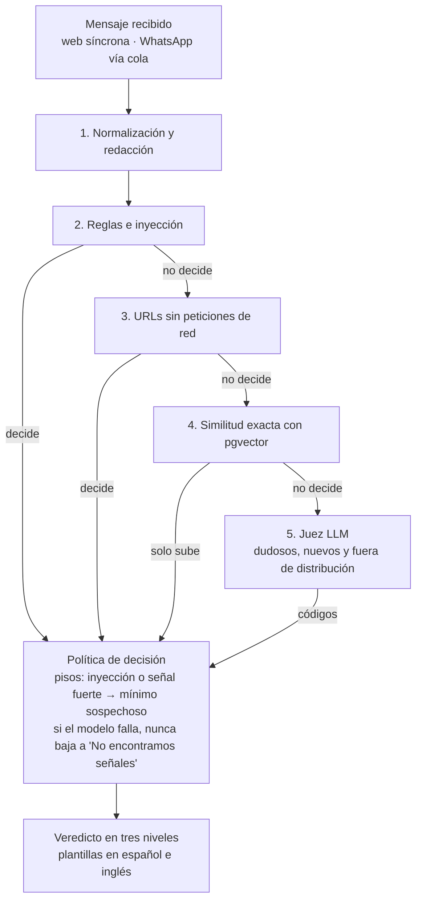

# ¿EsFake? — Especificación del MVP

Oct 6, 2026 · Alessandro David

> Archivos hermanos: `CLAUDE.md` (prompt maestro, en la raíz del repositorio) y `docs/BACKLOG.md` (historias EF-01 a EF-34 con criterios de aceptación).

## Visión y problema

¿EsFake? le dice a cualquier persona, en segundos y en lenguaje simple, qué señales de estafa tiene un mensaje que recibió, a qué modalidad conocida se parece y qué hacer. Se usa pegando o reenviando el mensaje: no hay que aprender una app nueva.

**El nombre y su regla.** El nombre es una pregunta, pero el producto nunca la responde con un "no": ningún texto de la interfaz dice "no es fake" ni "es seguro". El nivel más bajo se llama "No encontramos señales conocidas" y siempre recuerda que eso no garantiza que el mensaje sea legítimo. El paquete de código se llama `esfake`. Eslogan: "Verifica si un mensaje es una estafa antes de pagar" · "Is this message a scam? Check before you pay".

**El problema.** En 2024 la PNP registró 42 mil denuncias por delitos informáticos en el Perú, casi 40 % más que en 2023, y los ciberdelincuentes robaron 90 millones de soles solo en Lima, según el Sidpol de la PNP citado por RPP Data ([RPP](https://rpp.pe/lima/actualidad/pedro-gamio-exviceministro-denuncia-que-sujetos-intentaron-intervenir-su-cuenta-de-whatsapp-noticia-1624963)). Las modalidades se repiten: el familiar en apuros, el falso premio, el falso soporte que roba la cuenta de WhatsApp, el comprobante falso de Yape ([Perú Retail](https://www.peru-retail.com/cuidado-con-el-falso-yape-como-funciona-esta-nueva-modalidad-de-estafa-a-comerciantes/)) y, desde 2025, voces clonadas con IA ([Exitosa](https://www.exitosanoticias.pe/actualidad/atencion-nueva-modalidad-estafa-ia-delincuentes-clonan-voces-robar-n143678/amp)). La víctima suele tener la información para no caer, pero no en el momento en que la necesita.

**La propuesta.** Un pipeline por capas ordenadas de la más barata a la más cara: normalización y redacción, reglas, análisis de URLs, similitud contra un corpus etiquetado y un modelo de lenguaje solo para los casos dudosos o nuevos. El modelo nunca escribe lo que lee el usuario: devuelve códigos, y el texto sale de plantillas revisadas en español y en inglés.

**Usuarios objetivo.** Adultos mayores y sus familias, y bodegueros y comerciantes que cobran por Yape o Plin. Reciben las estafas por WhatsApp, así que WhatsApp es el canal del piloto. La web es el canal público y el de los reclutadores.

**Posicionamiento para portafolio.** El proyecto debe demostrar IA aplicada con rigor de ingeniería, no un envoltorio de una API: el pipeline se compara contra tres líneas base (palabras clave, un LLM solo y embeddings con regresión logística), la evaluación se publica por versión con intervalos de confianza, la entrada adversarial está contemplada en el diseño, y el costo, la latencia y la privacidad se miden. README, ADR y resultados públicos van en inglés; esta especificación y la interfaz para usuarios, en español.

**Métricas de éxito del MVP**

Positivo = un mensaje que sale `likely_scam` o `suspicious`. Falso positivo = un mensaje legítimo que sale con cualquier nivel distinto de `no_signals`.

| Métrica | Objetivo | Cómo se mide |
| --- | --- | --- |
| Recall sobre estafas textuales en `test` | ≥ 90 % como valor puntual, publicado con su intervalo de Wilson al 95 % | `make eval` en cada release; también el recall estricto (solo `likely_scam`) y la matriz 3×2 |
| Falsos positivos sobre mensajes legítimos en `test` | ≤ 5 % como valor puntual, con intervalo; por subcategoría de negativo difícil se reportan conteos, no porcentajes | Mismo informe |
| Comparación con el LLM solo | No inferioridad: el límite inferior del bootstrap pareado de la diferencia de recall es mayor que −10 puntos (margen fijado antes de medir y justificado en ADR-0006 por el tamaño del test), con menor costo y latencia; se publican la diferencia, su intervalo y los casos discordantes | Página de resultados, junto a las otras dos líneas base |
| Latencia p95 | ≤ 4 s en web y ≤ 10 s en WhatsApp | Trazas con presupuesto por capa |
| Verificaciones que usan el modelo | ≤ 40 %, con la proporción por ruta de entrada (zona dudosa, rasgo de riesgo, fuera de distribución) | `verdicts.llm_used` y `make eval` |
| Suites de ataque | 100 % en `redteam/dev` (gate de CI); `redteam/heldout` reportado en cada release, con el riesgo residual declarado | `make redteam` |
| Piloto | ≥ 20 personas de la cohorte, usuarios activos en la semana 2, % de "me sirvió", errores reportados y prueba de usabilidad con 3 a 5 adultos mayores | Código de cohorte y reporte del piloto |

Con unos 90 mensajes en `test`, los intervalos rondan ±9 puntos: el README defiende el pipeline por lo que el LLM solo no da (modalidad y acción concreta, costo controlado y pisos frente a manipulación), no solo por el recall.

## Alcance del MVP y funcionalidades

El MVP verifica mensajes de texto con enlaces por la web y por WhatsApp, con Telegram como canal de contingencia, y se apoya en un corpus etiquetado, tres líneas base, evaluación automática y etiquetado por CLI.

**Veredicto en tres niveles.** Ninguno responde la pregunta del nombre con un "no".

| Nivel | Cuándo | Qué ve el usuario |
| --- | --- | --- |
| Probable estafa | Señales fuertes, URL que imita a una marca o alta similitud con estafas conocidas | La modalidad, las señales y 2-3 acciones concretas, desde plantillas |
| Sospechoso | Señales mixtas, el modelo duda, o hay un piso de política (inyección o señal fuerte) | Las señales y cómo verificar antes de actuar |
| No encontramos señales conocidas | Ninguna capa encuentra señales | Que eso no garantiza que sea legítimo y cómo verificar si piden dinero o códigos |

**Modalidades.** Siete textuales, que el pipeline detecta y el corpus debe cubrir: familiar en apuros, falso premio o sorteo, suplantación de banco o billetera (phishing), falso soporte que pide el código de WhatsApp, falsa oferta de empleo, falso préstamo con pago adelantado y venta falsa en redes sociales. Dos son solo de orientación, porque no llegan como texto: el comprobante falso de Yape o Plin (se orienta a revisar la propia app) y el secuestro virtual (llega por llamada).

| Módulo | Funcionalidad | Detalle |
| --- | --- | --- |
| Web | Verificación pública | Aviso de privacidad visible antes del primer envío; sin registro; aviso de "calibrado para mensajes en español del Perú" solo con detección de otro idioma de confianza alta y un mínimo de caracteres |
| Web | Ejemplos precargados | Cuatro ejemplos redactados con traducción al inglés (familiar en apuros, enlace falso de banco, notificación legítima sin enlace y familiar en apuros con inyección), servidos desde veredictos fijados al manifiesto publicado y marcados como tales; no llaman al modelo ni dependen de los topes |
| Web | Modo técnico | Qué capa decidió, códigos de señal (sin pesos ni umbrales), vecinos del corpus (texto solo si su fuente no es una donación; "vecino retirado" si fue borrado), si se usó el modelo, latencia y costo |
| Web | Página pública de resultados | Métricas por versión con intervalos, no inferioridad frente al LLM solo, las otras líneas base y las suites de ataque, generadas desde `docs/evals/` |
| WhatsApp | Canal del piloto | Aviso de privacidad con botón "Acepto" antes de procesar cualquier mensaje; firma sobre el cuerpo crudo; webhooks de estado descartados; veredicto y feedback en un solo mensaje interactivo; a imágenes, audios o stickers, una respuesta de plantilla con tope por identidad |
| Telegram | Contingencia | Solo si la verificación de Meta no está lista al empezar el sprint 6 |
| Canales | Feedback y donación | "¿Te sirvió?" y "¿Nos equivocamos?"; donar es opt-in por mensaje y entrega un código de al menos 10 caracteres en base32 para pedir el borrado (en WhatsApp, ligado a la identidad); en la web, la donación se activa con un feature flag cuando el borrado esté listo |
| Pipeline | Normalización y redacción | NFKC, sin ancho cero, detección de idioma; redacción determinista de teléfonos, DNI, cuentas, tarjetas y correos, y de nombres PER con spaCy, sin tocar las marcas de la lista de exención |
| Pipeline | Reglas e inyección | Patrones con peso y modalidad, incluidas las señales de manipulación |
| Pipeline | URLs sin peticiones de red | Dominio registrado, acortadores, token de marca en dominio no oficial, confusables (UTS #39), IDN y punycode |
| Pipeline | Similitud | Búsqueda exacta; decide solo si los k vecinos coinciden y superan por δ al vecino legítimo más cercano; nunca decide "no encontramos señales" |
| Pipeline | Juez LLM | Para la zona dudosa, los mensajes con dinero, códigos o enlaces sin regla activa y los fuera de distribución, con la proporción por ruta medida; devuelve solo códigos |
| Pipeline | Política y plantillas | Puntaje y nivel con pisos y modo degradado definido; texto final desde plantillas es/en |
| Calidad | Líneas base | Palabras clave (~15), LLM solo zero-shot y embeddings + regresión logística |
| Calidad | Evaluación | Gate estadístico en `eval` con caché estricto; `test`, suites retenidas y evaluación en vivo en cada release |
| Operación | CLI `esfake` | `label` y `report`; en producción corre dentro del contenedor, y la evaluación "in the wild" solo exporta métricas |
| Operación | Topes | Por minuto y por día por IP o identidad; tope mensual del modelo con subtope diario; tope de WhatsApp con su franquicia |
| Privacidad | Retención | El texto se vacía a los 30 días, salvo las donaciones pendientes, que lo conservan hasta etiquetarse o descartarse (máximo 90 días); el corpus donado se conserva 2 años o hasta que el usuario lo retire; la dirección de respuesta se borra al enviar o a las 24 h |

**Fuera del MVP:** consola web de etiquetado y panel interno, Telegram (salvo contingencia), análisis de capturas (OCR), notas de voz, verificación de comprobantes, apps móviles, cuentas de usuario, detección de sondeo por clústeres, política aprendida en producción, bloqueo de números y cualquier lista pública de números o cuentas.

**Escenario de demo obligatorio.** En la web, con los ejemplos fijados: (1) el familiar en apuros sale "Probable estafa" decidido por reglas, sin llamar al modelo; (2) el enlace que imita a un banco sale "Probable estafa" por el análisis de URLs; (3) la notificación legítima sin enlace sale "No encontramos señales conocidas" con su advertencia; (4) el familiar en apuros con una inyección sale "Probable estafa" y el modo técnico muestra la señal de inyección. Luego, un mensaje escrito en vivo para mostrar el pipeline real. Cierra con la página de resultados: no inferioridad frente al LLM solo, con menor costo y latencia.

## Arquitectura

Cada mensaje pasa por cinco capas ordenadas de la más barata a la más cara; el modelo de lenguaje solo recibe los casos dudosos, nuevos o fuera de distribución, y nunca escribe el texto que lee el usuario.



Reglas, URLs y similitud pueden decidir solas; la similitud solo puede subir el nivel, nunca bajarlo a "no encontramos señales".

| Componente | Tecnología | Responsabilidad |
| --- | --- | --- |
| `esfake.api` | FastAPI | En producción, el único proceso que carga el modelo de embeddings y ejecuta el pipeline; verificación web síncrona; webhooks (responden 200 de inmediato y encolan); readiness solo con el modelo cargado; obtiene la IP del cliente solo de una lista de proxies de confianza |
| `esfake.api` (listener interno) | FastAPI, puerto no publicado | `/internal/verify` para el worker y /internal/embed para la CLI, con secreto compartido; segundo uvicorn.Server en el mismo loop de asyncio, que comparte el modelo cargado; no es alcanzable desde fuera |
| `worker channels` | Python, asyncpg | Despierta con `LISTEN/NOTIFY` por una conexión directa, no por el pooler (respaldo cada 5 s), llama a `/internal/verify`, responde por la API del canal y marca `sent_at` |
| `worker maintenance` | Python | Vacía textos vencidos, borra direcciones de respuesta y filas enviadas o fallidas a las 24 h, borra una vez al mes el corpus donado con retain_until vencido (un solo incremento de dataset_version), purga ventanas de rate limit y cierra los topes |
| `web` | Next.js | Aviso de privacidad, verificación pública, ejemplos fijados, modo técnico y página de resultados |
| CLI `esfake` | Python | `label`, `report`, `eval`, `eval-record`, `redteam`; en producción corre dentro del contenedor de producción y pide embeddings a /internal/embed |
| PostgreSQL 16 | pgvector | Datos, corpus, cola, topes y libro de gastos |

**Orden del pipeline y presupuesto de latencia (p95 ≤ 4 s en web)**

1. **Normalización y redacción** (≤ 150 ms). NFKC, sin caracteres de ancho cero, detección de idioma. Redacción determinista de teléfonos, DNI, cuentas, tarjetas (con Luhn) y correos; spaCy solo para entidades PER, con una lista de marcas exentas (BCP, Interbank, Yape…) tomada de `official_domains.yaml` y `modalities.yaml`; patrón para el titular de Yape. Se descartan los metadatos de reenvío. El texto crudo no se guarda en ningún momento.
2. **Reglas e inyección** (≤ 30 ms). Señales con peso y modalidad desde `config/rules.yaml`, incluidas las de manipulación.
3. **URLs** (≤ 20 ms, sin red). Public Suffix List, acortadores, token de marca en un dominio no oficial, esqueleto UTS #39, distancia normalizada, IDN y punycode.
4. **Similitud** (≤ 200 ms). Embedding de 384 dimensiones y búsqueda exacta sobre `index`. Decide solo si los k vecinos coinciden en estafa y superan por δ al vecino legítimo más cercano (valores iniciales en `thresholds.yaml`). Guarda los ids de los vecinos.
5. **Juez LLM** (timeout 3 s). Entra por tres rutas, cuya proporción se mide: zona dudosa, rasgo de riesgo (dinero, códigos o enlaces) sin regla activa, y fuera de distribución. Recibe el mensaje delimitado, las señales previas y los vecinos como etiqueta, modalidad y score; devuelve nivel, modalidad, códigos y offsets.
6. **Política y plantillas** (≤ 50 ms). Puntaje con umbrales ajustados sobre `eval` (antes de EF-15, una política v0 de umbral simple sobre la suma de pesos). Pisos de inyección y de señal fuerte. Texto final desde plantillas es/en.

**Por qué el modelo no escribe, y qué riesgo queda.** Si el modelo pudiera redactar la explicación, una inyección exitosa podría hacer que la estafa llegue con la autoridad del verificador. Con salida de solo códigos, el peor caso es un nivel equivocado. Los pisos lo limitan cuando hay una señal fuerte o de inyección, pero queda un riesgo residual: una inyección que escape a las reglas, en un mensaje sin señales fuertes, puede llevar el veredicto a "no encontramos señales". ADR-0001 y el README lo declaran, con su medición en `redteam/heldout`.

**Modo degradado.** Si el modelo falla, tarda más de 3 s, responde algo inválido o se alcanza su tope (mensual, con subtope diario), lo que se habría enviado al modelo sale "Sospechoso" con una plantilla de "verificación limitada", y se mide la tasa de falsos positivos en ese modo. Los ejemplos precargados no dependen del modelo, así que la demo no se degrada aunque se agote el tope.

**Canales asíncronos.** Si la identidad no aceptó el aviso de privacidad, el webhook no crea una verificación: responde con el aviso y un botón "Acepto" y pide reenviar el mensaje. Con el aviso aceptado, verifica la firma sobre el cuerpo crudo, descarta los webhooks de estado, deduplica por el HMAC del id del mensaje (`wamid` o `update_id`, probando todos los `key_id` activos) y encola con la dirección de respuesta cifrada (AES-GCM, clave distinta de la del HMAC). El worker sigue la regla 7 del prompt maestro. En `failed_at`, el usuario recibe "no pudimos verificar este mensaje; no envíes dinero hasta confirmarlo por otro medio". La entrega es al menos una vez: si un worker cae entre el envío y `sent_at`, el mensaje puede duplicarse, y si cae antes, la respuesta puede tardar hasta 60 s más.

**Costos y topes.** Desde el 1 de octubre de 2026, Meta cobra por cada mensaje de servicio enviado en la ventana de 24 horas. Cada número de negocio recibe 1.000 mensajes de servicio entregados gratis al mes y se cobra desde el 1.001 ([Teramont](https://teramont.net/blog/whatsapp-business-platform-service-message-pricing-2026), [meetergo](https://help.meetergo.com/en/integrations/automation/whatsapp-pricing)); EF-01 lo confirma en la documentación oficial de Meta. El piloto se estima en mensajes: aviso, confirmación y primer veredicto por usuario nuevo (unos 3) más un mensaje por cada verificación posterior; con 20 personas y unas 10 verificaciones cada una, son unos 240 mensajes, más los códigos de donación y algún "gracias" por feedback; todo cabe en la franquicia. `spend_ledger` lleva el gasto de WhatsApp y del modelo; al alcanzar un tope de WhatsApp, cada identidad recibe un único aviso con el enlace a la web. La infraestructura corre gratis en una VM de Oracle Cloud Always Free (ARM, siempre encendida). Docker Compose levanta en ella la API, los workers, la web y Postgres con pgvector, administrado por el proyecto y con un backup diario que se conserva 30 días. ADR-0003 registra la decisión, sus riesgos y el plan B de pago. El despliegue es continuo: cada merge a `main` con el CI en verde se construye en la VM y se despliega por SSH con rollback automático (ADR-0007), y se activa recién después de EF-25.

**Escalado futuro.** API y workers son stateless. La búsqueda exacta es más rápida y precisa que un índice aproximado hasta decenas de miles de vectores; la interfaz `SimilarityIndex` permite pasar a HNSW cuando el corpus lo justifique.

## Esquema de base de datos

Una base PostgreSQL 16 con pgvector y 16 tablas en tres grupos. Las reglas, los dominios oficiales, las plantillas, los prompts y las suites de ataque NO viven en la base: son archivos versionados en el repositorio, para que cada evaluación se reproduzca desde un commit. Un script de arranque, ejecutado una vez como superusuario, crea los roles y la extensión `vector` (ADR-0002). La primera migración de Alembic, ejecutada por `esfake_owner`, conserva `CREATE EXTENSION IF NOT EXISTS`, así que funciona igual en local, en CI y en producción.

Las claves primarias son `uuid` v7 generados en la aplicación, salvo `modalities` (su `code`), `verification_queue` y `audit_log` (`bigint` identity), `pipeline_manifests` (su hash) y las tablas con clave compuesta. Todo HMAC (identidades, ids de mensaje, texto, claves de rate limit) se guarda con el prefijo de su `key_id`; durante una rotación, la deduplicación y la búsqueda de identidad prueban todos los `key_id` activos.

### Verificación

| Tabla | Columnas principales | Restricciones clave |
| --- | --- | --- |
| `channel_identities` | id, channel, external_id_hmac, privacy_notice_accepted_at, pilot_cohort, language, created_at | `(channel, external_id_hmac)` único; channel ∈ web, whatsapp, telegram; sin aviso aceptado no se crean verificaciones |
| `verifications` | id, identity_id (nullable en web), channel, external_message_hmac, received_at, text_redacted (nullable), text_hmac, language, redaction_counts `jsonb`, status, manifest_hash, latency_ms, privacy_notice_version, donated_at, consent_version, donation_code_hash, text_purged_at | `(channel, external_message_hmac)` único; status ∈ pending, done, failed; privacy_notice_version obligatoria en todos los canales; el texto se vacía a los 30 días, o al etiquetarse o descartarse si fue donado (máximo 90 días) |
| `verification_queue` | id, verification_id, reply_address_enc, enqueued_at, available_at, attempts, last_error, sent_at, failed_at | `reply_address_enc` cifrado con AES-GCM; filas enviadas o fallidas y direcciones borradas a las 24 h; índice parcial en `available_at` WHERE `failed_at IS NULL AND sent_at IS NULL` |
| `urls` | id, verification_id, url_redacted (nullable), registered_domain, is_shortener, is_idn, brand_token, lookalike_of, lookalike_score | `lookalike_of` = dominio oficial imitado, del archivo versionado |
| `signals` | id, verification_id, layer, code, weight, modality_code, evidence_spans `jsonb`, neighbor_ids `uuid[]`, detail `jsonb` (nullable) | layer ∈ rules, injection, urls, similarity, llm; un vecino borrado del corpus se muestra como "vecino retirado" |
| `verdicts` | verification_id (PK), level, score, modality_code, template_ids, route, llm_used, llm_model, prompt_version, input_tokens, output_tokens, cost_usd, degraded, decided_at | level ∈ likely_scam, suspicious, no_signals; route ∈ early_exit, gray_zone, risk_trait, out_of_distribution, no_route; CHECK: `likely_scam` exige `modality_code`; CHECK: campos del modelo nulos si y solo si `llm_used` es falso |
| `feedback` | id, verification_id, helpful, user_label, created_at | `verification_id` único; user_label ∈ scam, legit, unsure |

### Corpus y evaluación

| Tabla | Columnas principales | Restricciones clave |
| --- | --- | --- |
| `modalities` | code (PK), kind, name_es, name_en, guidance_es, guidance_en, is_active | kind ∈ textual, guidance_only; sembrada desde `config/modalities.yaml` con la misma clave en todos los entornos |
| `corpus_messages` | id, case_id, source, source_verification_id (nullable), text_redacted, label, modality_code, subcategory, language, cluster_id, split, split_assigned_at, embedding `vector(384)`, embedding_model, dataset_version, retain_until, added_by, added_at | case_id único y estable: viene del JSONL en el corpus público y es el id de la verificación en las donaciones; label ∈ scam, legit; source ∈ public_alert, donated, curated_legit, synthetic; split ∈ index, eval, test, excluded; congelado al asignarse y heredado por el clúster; excluded = mensajes que unen clústeres de splits distintos, contados para auditar; CHECK `(label <> 'legit' OR subcategory IS NOT NULL)`, con `easy` para negativos fáciles; CHECK: `synthetic` nunca en test; `retain_until` = 2 años para donaciones |
| `labeling_tasks` | id, verification_id, status, label, modality_code, subcategory, labeled_by, labeled_at | status ∈ pending, labeled, discarded; solo para verificaciones con `donated_at` |
| `pipeline_manifests` | manifest_hash (PK), git_sha, embedding_model, llm_model, llm_params `jsonb`, prompt_version, redactor_version, thresholds_version, index_snapshot, created_at | Identifica exactamente qué produjo un veredicto o una evaluación |
| `eval_runs` | id, manifest_hash, baseline_manifest_hash, dataset_version, suite, mode, repetitions, live_calls, started_at, finished_at, metrics `jsonb`, passed, imported_from | suite ∈ eval, test, redteam_dev, redteam_heldout, wild, baseline_keywords, baseline_llm, baseline_logreg; mode ∈ cached_strict, record, live; las corridas de CI llegan desde `docs/evals/<versión>.json`; la evaluación "wild" corre en producción y solo exporta métricas |
| `eval_results` | run_id, case_source, case_id, expected_label, predicted_level, route, correct, llm_used, live_call, latency_ms, cost_usd | PK `(run_id, case_source, case_id)`; case_source ∈ corpus, redteam |

### Operación

| Tabla | Columnas principales | Restricciones clave |
| --- | --- | --- |
| `spend_ledger` | scope, period_kind, period_start, free_quota, units, billable_units, cost_usd, cap_usd, capped_at | PK `(scope, period_kind, period_start)`; scope ∈ whatsapp, llm; period_kind ∈ month, day (el subtope diario del modelo); `free_quota` = 1.000 mensajes de servicio por número y mes para WhatsApp |
| `rate_limit_windows` | key_hmac, route, window_kind, window_start, request_count | PK `(key_hmac, route, window_kind, window_start)`; window_kind ∈ minute, day; el borrado por código tiene su propia `route` y su propio límite |
| `audit_log` | id, actor, action, entity_type, entity_id, changed_fields `text[]`, at | append-only; nunca texto de mensajes; en la CLI, `actor` sale de una variable de configuración |

### Cómo se relacionan

- Una **identidad de canal** tiene muchas **verificaciones**, pero solo después de aceptar el aviso de privacidad; en la web la verificación no tiene identidad.
- Cada **verificación** tiene sus **URLs**, sus **señales**, un **veredicto** (1:1), como mucho un **feedback** y, mientras espera respuesta, una fila en la **cola**. Apunta al **manifiesto** que la produjo.
- Al donar, nace una **tarea de etiquetado** y el texto se conserva hasta etiquetarse o descartarse (máximo 90 días). Al etiquetarla, el mensaje entra al **corpus** con `source_verification_id`; si se une a un clúster existente hereda su split, y si une clústeres de splits distintos queda excluido de todos los splits.
- Pedir el borrado con el código de donación elimina el texto de la verificación, la tarea pendiente y la fila del corpus, y aumenta `dataset_version`.
- A los 30 días, en mensajes no donados, se vacían `text_redacted`, `url_redacted` y `detail`; la verificación, sus señales y su veredicto se conservan como metadatos para costo y métricas.
- Cada **corrida de evaluación** apunta a su manifiesto y al de la versión publicada contra la que compara, y guarda un **resultado** por caso, del corpus o de las suites del repositorio.

## Plan de sprints

Ocho sprints de dos semanas, del 12 de octubre de 2026 al 31 de enero de 2027, con entre 13 y 17 puntos cada uno. El cumplimiento legal queda listo antes de desplegar producción, la web pública sale en la primera semana de enero y el piloto ocupa las dos últimas semanas. Si cerrar Vigía toma más de lo previsto, corre todas las fechas en bloque en vez de solapar proyectos.

| Sprint | Fechas | Objetivo | Historias, en orden | Pts |
| --- | --- | --- | --- | --- |
| 0 | 12 – 25 oct | ADR decididos, todo levanta con `make up`, CI en verde y trámite de Meta iniciado | EF-01, 02, 03, 04, 05 | 15 |
| 1 | 26 oct – 8 nov | Redacción probada, corpus sin fugas y `make eval` funcionando con la política v0 | EF-06, 07, 08 | 15 |
| 2 | 9 – 22 nov | Tres líneas base publicadas y reglas medidas contra ellas | EF-10, 11 | 13 |
| 3 | 23 nov – 6 dic | URLs, similitud, juez LLM y política final con pisos y modo degradado | EF-12, 13, 14, 15 | 16 |
| 4 | 7 – 20 dic | Cumplimiento legal, producción desplegada, plantillas y suites de ataque | EF-25, 19, 18, 16, 17 | 17 |
| 5 | 21 dic – 3 ene | Demo pública: API segura, web con ejemplos y modo técnico, página de resultados | EF-20, 21, 22 | 14 |
| 6 | 4 – 17 ene | WhatsApp (o Telegram, si Meta no aprobó), donaciones con borrado y etiquetado | EF-23, 24, 26 | 14 |
| 7 | 18 – 31 ene | Piloto con la cohorte, README y video, versión 1.0 | EF-28, 29, 27, 30 | 15 |

**El corpus no espera al código.** EF-09 va fuera de la velocidad porque es la tarea más larga del proyecto. Necesitas al menos 400 mensajes antes del sprint 2 (para medir las líneas base) y 600 al cierre del sprint 3. Puedes avanzarlo mientras cierras Vigía, a partir de alertas públicas de bancos, de la PNP y de medios, y de mensajes legítimos con consentimiento.

**Decisión del sprint 6.** Si al empezar el 4 de enero Meta todavía no aprobó el número, EF-31 (Telegram) reemplaza a EF-23 con los mismos criterios, y la cohorte del piloto usa Telegram.

**Reclutamiento del piloto.** Durante el sprint 5, arma la cohorte (familia, vecinos, bodegueros cercanos) y dales el enlace con su código. Así el piloto empieza el primer día del sprint 7.

**Orden de recorte si un sprint no cierra:** primero EF-27 (reporte por CLI), luego la política aprendida de EF-15 (queda solo con umbrales) y por último el modo técnico reducido a capa y señales. La evaluación, la privacidad y las suites de ataque no se recortan.

**Cada sprint deja evidencia para el portafolio:** su archivo en `docs/evals/` con la comparación frente a las líneas base. Al final tendrás la evolución completa de la versión 0 a la 1.0.

## Requisitos no funcionales, privacidad y seguridad

Un falso "no encontramos señales" puede costarle dinero a alguien, así que el diseño prioriza no tranquilizar de más sobre no alarmar de más, y nunca guarda más datos de los necesarios.

| Categoría | Requisito | Cómo se verifica |
| --- | --- | --- |
| Calidad | Recall ≥ 90 % y falsos positivos ≤ 5 % en `test` como valores puntuales, publicados con intervalo de Wilson; en cada PR, ninguna regresión significativa en `eval` frente a las predicciones guardadas de la versión publicada, sobre los casos comunes a ambos datasets; pisos absolutos en eval (recall ≥ 85 %, falsos positivos ≤ 8 %) desde la primera versión publicada tras EF-15 | `make eval` cached-strict en CI y en release |
| Comparación | No inferioridad frente al LLM solo (límite inferior del bootstrap pareado > −10 puntos de recall, margen de ADR-0006; se publican diferencia, intervalo y casos discordantes) con menor costo y latencia; las otras dos líneas base se publican al lado | Página de resultados |
| Robustez | 100 % en `redteam/dev`; `redteam/heldout` reportado con su conteo; una señal de inyección es un piso de "sospechoso"; riesgo residual declarado en ADR-0001 y README | `make redteam` |
| Salida del modelo | Solo códigos y offsets; todo texto visible sale de plantillas; ningún texto dice "seguro" ni "no es fake" | Test de esquema y de plantillas |
| Modo degradado | Con el modelo caído, lento, inválido o con tope, lo enrutado al modelo sale "Sospechoso" con plantilla de verificación limitada; su tasa de falsos positivos se mide; los ejemplos de la demo no dependen del modelo | Tests con proveedor caído, salida inválida y tope; evaluación en modo degradado |
| Latencia | p95 ≤ 4 s en web con presupuesto por capa; ≤ 10 s en WhatsApp, con entrega al menos una vez y hasta 60 s más si cae un worker (documentado) | Trazas por capa |
| Costo | ≤ 40 % de verificaciones usan el modelo, con la proporción por ruta; tope mensual del modelo con subtope diario; tope de WhatsApp con franquicia de 1.000 mensajes de servicio por número y mes; costo de infraestructura en ADR-0003 | `verdicts`, `spend_ledger` |
| Privacidad | El texto crudo nunca se persiste ni se envía; redacción determinista al 100 % en canarios y recall de nombres sobre el piso de ADR-0004; marcas exentas de la redacción; HMAC con `key_id` en identidades, ids de mensaje y texto; dirección de respuesta cifrada y borrada a las 24 h; texto vaciado a los 30 días (90 como máximo si está donado y pendiente) | Canarios en dump de BD, logs y payload del LLM; jobs probados con FakeClock |
| Consentimiento y borrado | Sin aviso aceptado no se procesa ningún mensaje; donación opt-in por mensaje con `consent_version`; borrado con código de ≥ 10 caracteres que elimina texto, tarea y fila del corpus; corpus donado retenido 2 años o hasta que se retire | Flujos probados en web y WhatsApp |
| Marco legal | Ley 29733 y su reglamento vigente, verificados contra el texto oficial antes de desplegar (EF-25) | Lista de verificación completa en el sprint 4 |
| Abuso | Topes por minuto y por día por IP o identidad, con IP tomada solo de proxies de confianza; `/internal/verify` en un listener no publicado con secreto; el modo técnico no muestra pesos, umbrales ni texto de donaciones; firma de WhatsApp sobre el cuerpo crudo; rate limit propio para el borrado | Tests de 429, de header falsificado, de acceso externo y de firma inválida |
| Seguridad web | Resaltado por offsets sin HTML del usuario; URLs neutralizadas y no clicables; ninguna petición de red a URLs de mensajes | Tests de XSS y de red |
| Reproducibilidad | Todo veredicto y evaluación apunta a un manifiesto; split congelado; la evaluación en vivo se repite N = 3 para medir la varianza del modelo | Re-ejecutar una evaluación en caché desde su manifiesto da las mismas métricas |
| Fuga de datos | Split por clúster congelado y heredado; ningún mensaje de `eval` o `test` con vecino en `index` sobre el umbral; sintéticos fuera de `test` | Test automático y CHECK en BD |
| Accesibilidad y lenguaje | WCAG 2.1 AA; plantillas en frases cortas; aviso de idioma solo con confianza alta y un mínimo de caracteres | Playwright + axe; usabilidad con 3 a 5 adultos mayores |
| Observabilidad | Logs JSON con `verification_id`, tiempo y costo por capa, sin texto de mensajes | Test de canarios sobre los logs capturados |

**Límites éticos explícitos.** ¿EsFake? nunca afirma que un mensaje es seguro, nunca publica listas de números o cuentas (pueden ser de víctimas cuyo teléfono fue robado) y no reemplaza a la policía ni al banco: cada "probable estafa" recomienda verificar por el canal oficial y denunciar. El producto, la demo y el README deben decirlo.

## Repositorio, convenciones y documentación viva

Un monorepo donde la configuración del pipeline y los datos de evaluación viven junto al código, para que cada resultado publicado se reproduzca desde su manifiesto.

```text
esfake/
├── backend/
│   ├── src/esfake/
│   │   ├── shared/               # Clock, config, db, logging, hmac, crypto
│   │   ├── channels/             # web, whatsapp, telegram (contingencia)
│   │   ├── pipeline/
│   │   │   ├── normalize/        # NFKC, ancho cero, idioma
│   │   │   ├── redaction/        # regex, spaCy, titular de Yape
│   │   │   ├── rules/            # incluye señales de inyección
│   │   │   ├── urls/             # sin peticiones de red
│   │   │   ├── similarity/
│   │   │   ├── llm/prompts/
│   │   │   ├── decision/
│   │   │   └── templates/        # es y en
│   │   ├── corpus/               # clústeres y splits
│   │   ├── evaluation/           # eval, redteam, líneas base, estadística
│   │   ├── cli/                  # esfake corpus assign | label | report | eval | eval-record | redteam
│   │   ├── api/main.py
│   │   └── workers/              # channels, maintenance
│   ├── migrations/
│   └── tests/{unit,integration,canaries}/
├── web/                          # Next.js: verificación, modo técnico, resultados
├── config/{rules,official_domains,modalities,thresholds}.yaml
├── evals/
│   ├── datasets/                 # JSONL redactado, solo fuentes públicas o con consentimiento
│   ├── llm_cache/                # respuestas del modelo en caché (fixtures)
│   └── redteam/{dev,heldout}/
├── docs/
│   ├── SPEC.md                   # este documento, sin el backlog
│   ├── BACKLOG.md
│   ├── adr/                      # en inglés
│   ├── evals/                    # <versión>.json por release
│   └── sprints/                  # en español
├── deploy/                       # deploy.sh y smoke.sh (ADR-0007)
├── .github/workflows/            # ci.yml y cd.yml (ADR-0007)
├── docker-compose.yml
├── Makefile
├── CLAUDE.md
└── README.md                     # en inglés
```

| Artefacto | Propósito | Cuándo se actualiza |
| --- | --- | --- |
| `docs/SPEC.md` | Visión, arquitectura, esquema y requisitos; importado por `CLAUDE.md` | Al cambiar alcance o contrato |
| `docs/BACKLOG.md` | Historias con criterios de aceptación; se lee por historia, no se importa | Al cerrar o cambiar una historia |
| `CLAUDE.md` | Prompt maestro | Al cambiar convenciones o stack |
| `docs/adr/` | Decisiones técnicas en inglés | Cada decisión no trivial |
| `docs/evals/` | Resultados por versión, importados a producción para la página pública | Cada release |
| `README.md` | Para reclutadores: problema, diagrama, resultados frente a líneas base, decisiones, demo y QR | Al cierre de cada sprint |
| `CHANGELOG.md` | Cambios por versión (Keep a Changelog + SemVer) | Cada release |

**Idioma.** SPEC.md, BACKLOG.md, `docs/sprints/` y la interfaz para usuarios van en español, porque son documentos de trabajo y el producto es para el Perú. README, ADR, resultados públicos, código y comentarios van en inglés. Es una excepción declarada a la regla de documentación pública en inglés.

**Lo que nunca va al repositorio:** mensajes donados por usuarios (solo en la base), secretos, claves HMAC o de cifrado y datos sin redactar.

**Antes de EF-02:** confirma la disponibilidad de `esfake` como nombre de paquete, organización de GitHub, dominio y usuario de bot, y haz una búsqueda de marca en Indecopi.

**Convenciones.** Ramas `feat/EF-NN-descripcion`; Conventional Commits; cada PR que toque el pipeline adjunta su tabla de `make eval`; tablas y columnas en inglés `snake_case`.

## Fuentes

Las URL van completas para que sigan visibles al exportar a PDF.

- Cifras del Sidpol (PNP) sobre delitos informáticos en 2024 (42 mil denuncias, 90 millones de soles en Lima), vía RPP Data, dentro de una nota sobre otro tema: [RPP](https://rpp.pe/lima/actualidad/pedro-gamio-exviceministro-denuncia-que-sujetos-intentaron-intervenir-su-cuenta-de-whatsapp-noticia-1624963) — https://rpp.pe/lima/actualidad/pedro-gamio-exviceministro-denuncia-que-sujetos-intentaron-intervenir-su-cuenta-de-whatsapp-noticia-1624963
- Modalidad del "falso Yape": [Perú Retail](https://www.peru-retail.com/cuidado-con-el-falso-yape-como-funciona-esta-nueva-modalidad-de-estafa-a-comerciantes/) — https://www.peru-retail.com/cuidado-con-el-falso-yape-como-funciona-esta-nueva-modalidad-de-estafa-a-comerciantes/
- Estafas con voces clonadas por IA: [Exitosa](https://www.exitosanoticias.pe/actualidad/atencion-nueva-modalidad-estafa-ia-delincuentes-clonan-voces-robar-n143678/amp) — https://www.exitosanoticias.pe/actualidad/atencion-nueva-modalidad-estafa-ia-delincuentes-clonan-voces-robar-n143678/amp
- Cobro de mensajes de servicio de WhatsApp desde octubre de 2026 y franquicia: [Teramont](https://teramont.net/blog/whatsapp-business-platform-service-message-pricing-2026) — https://teramont.net/blog/whatsapp-business-platform-service-message-pricing-2026
- Precios de WhatsApp desde octubre de 2026: [meetergo](https://help.meetergo.com/en/integrations/automation/whatsapp-pricing) — https://help.meetergo.com/en/integrations/automation/whatsapp-pricing
